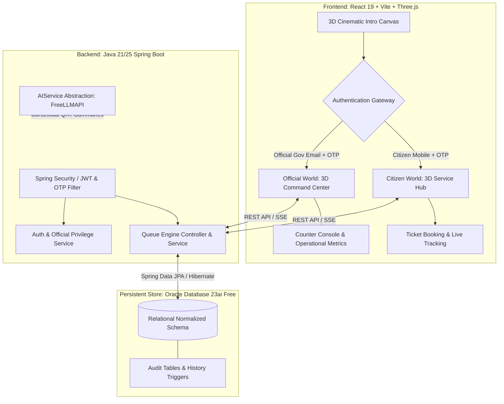

# MeeSeva DQMS — System Architecture & Specification Document
**Telangana State Digital Queue Management System (మీసేవ డిజిటల్ క్యూ నిర్వహణ వ్యవస్థ)**

---

## 1. Executive Summary & Project Objective

The **MeeSeva Digital Queue Management System (DQMS)** is a mission-critical, enterprise-grade government technology platform engineered for the Government of Telangana. The platform modernizes citizen service delivery across all 33 Telangana districts by replacing physical, crowded queues with a virtual, transparent, and deterministic digital queue lifecycle.

### Core Transformation Mandate
- **Source of Truth Transformation**: Transition from the standalone single-file HTML prototype (`prototype/meeseva-prototype.html`) into a robust full-stack production application.
- **Elimination of Fake/Simulated Logic**: Completely eliminate `Math.random()`, dummy math offsets, and client-side `setInterval()` queue ticks. Every ticket number, wait estimate, queue position, and counter assignment must be backed by a relational database state machine.
- **Futuristic Government Tech Aesthetic**: Redesign the interface with an authoritative, modern digital experience featuring interactive Three.js / React Three Fiber 3D environments, adaptable light/dark themes, and accessible typography.
- **Two Distinct Post-Login Worlds**:
  1. **Citizen Portal**: Welcoming, calm, transparent, and mobile-first, guiding citizens through service selection, virtual ticket booking, and live queue tracking.
  2. **Government Official Portal**: Command-and-control operations center providing live counter management, call/serve/complete actions, service demand metrics, and district/office oversight. No visible "Switch Role" selector exists—all official permissions are derived server-side from authenticated government accounts.
- **Strict Phased Iterations**: Development progresses iteratively without skipping foundational stability or mixing architectural phases.

---

## 2. Audit of Existing Prototype & Baseline Assets

### 2.1 Reference Prototype Inspection (`prototype/meeseva-prototype.html`)
The audited prototype provides the functional benchmark for business entities, district coverage, and service hierarchies:

1. **Telangana District Coverage (All 33 Districts)**:
   - `ADB`: Adilabad, `BDK`: Bhadradri Kothagudem, `HNK`: Hanamkonda, `HYD`: Hyderabad, `JGT`: Jagtial, `JNG`: Jangaon, `JBP`: Jayashankar Bhupalpally, `JGD`: Jogulamba Gadwal, `KMR`: Kamareddy, `KRN`: Karimnagar, `KHM`: Khammam, `KBA`: Kumuram Bheem Asifabad, `MBD`: Mahabubabad, `MBN`: Mahabubnagar, `MNC`: Mancherial, `MDK`: Medak, `MCM`: Medchal-Malkajgiri, `MLG`: Mulugu, `NGK`: Nagarkurnool, `NLG`: Nalgonda, `NRP`: Narayanpet, `NRM`: Nirmal, `NZB`: Nizamabad, `PED`: Peddapalli, `RJS`: Rajanna Sircilla, `RNG`: Ranga Reddy, `SNG`: Sangareddy, `SDP`: Siddipet, `SRP`: Suryapet, `VKR`: Vikarabad, `WNP`: Wanaparthy, `WGL`: Warangal, `YDB`: Yadadri Bhuvanagiri.

2. **Master Service Catalog**:
   - **Revenue Department (`REV`)**:
     - Token Prefix: `REV-`
     - Associated Counters: `Counter 01 & 02`
     - Average Service Time: `4 minutes`
     - Sub-Services: Income Certificate, Caste / Community Certificate, Residence / Nativity Certificate, Legal Heir Certificate, Encumbrance Certificate (EC), Adangal / Pahani Copies, OBCC Certificate.
     - Locations: MeeSeva Centers, Tahsildar / MRO Urban Offices, Market Yard Centers.
   - **Civil Registration & Municipal Services (`REG`)**:
     - Token Prefix: `CR-`
     - Associated Counters: `Counter 03`
     - Average Service Time: `3 minutes`
     - Sub-Services: Birth Certificate Issue / Correction, Death Certificate Issue, Child Name Inclusion, Property Tax Payment, Trade License Renewal, Water Connection Approval.
     - Locations: Municipal Complexes, RTC Bus Stand Colony Centers, GHMC Head Office.
   - **Transport Department RTA (`RTA`)**:
     - Token Prefix: `RTA-`
     - Associated Counters: `Counter 04 & 05`
     - Average Service Time: `6 minutes`
     - Sub-Services: LLR Slot Booking, Driving License Renewal, Vehicle Ownership Transfer (Duplicate RC), Fitness Certificate Request, Address Change in DL/RC.
     - Locations: District RTO Testing Tracks, RTO Junction MeeSeva Centers.
   - **Civil Supplies & Ration Services (`CIVIL`)**:
     - Token Prefix: `CS-`
     - Associated Counters: `Counter 06`
     - Average Service Time: `5 minutes`
     - Sub-Services: New Food Security Card (Ration Card), Member Addition / Deletion, Address Modification.
     - Locations: Civil Supplies Bhavan, Civil Line MeeSeva Centers.
   - **Electricity & Utility Services (`ELEC`)**:
     - Token Prefix: `ELE-`
     - Associated Counters: `Counter 07`
     - Average Service Time: `2 minutes`
     - Sub-Services: Electricity Bill Payment, New Service Connection Registration, Category Transfer / Name Change.
     - Locations: DISCOM Circle Offices, Electricity Substation Centers.

3. **Urban Center Map Overrides**:
   - Hyderabad (`HYD`): Sanath Nagar, SR Nagar, Yousufguda, MRO Khairatabad, Borabanda, GHMC Tank Bund.
   - Hanamkonda (`HNK`): Main Road Hanamkonda, Kazipet Railway Gate.
   - Nizamabad (`NZB`): Pragathi Nagar, Kanteshwar.

4. **Flaws Identified in Prototype**:
   - Token numbers generated via `Math.floor(Math.random() * 40) + 10` + arbitrary offsets.
   - Queue movement simulated via `setInterval(simulateQueueProgress, 4000)`.
   - Zero persistent storage; refreshing browser destroys active ticket.
   - Zero authentication; anyone can enter any mobile number without verification.
   - No government official interface, counter assignment mechanism, or audit log.

---

## 3. Technology Stack & Environment Validation

### 3.1 Environment Capabilities Confirmed on System
- **Runtime Environment**: Windows x64 PowerShell
- **Java SDK**: Eclipse Adoptium OpenJDK 25 (`C:\Program Files\Eclipse Adoptium\jdk-25.0.3.9-hotspot\bin\java.exe`)
- **Oracle Database**: Oracle Database 23ai / 26ai Free installed and active:
  - Windows Services: `OracleServiceFREE` (RUNNING), `OracleOraDB23Home1TNSListener` (RUNNING)
  - Port: `1521` (default TNS listener), Service Name: `FREE` / `FREEPDB1`
  - CLI: `C:\app\garen\product\26ai\dbhomeFree\bin\sqlplus.exe`
- **Node.js & Tooling**: Node.js `v24.17.0`, npm `11.8.0`, Vite `8.2.0`, React `19.2.8`, Tailwind CSS `v4.3.3`, Three.js `0.185.1`, `@react-three/fiber` `9.7.0`, `@react-three/drei` `10.7.8`.

### 3.2 Target Multi-Tier Architecture


---

## 4. Database Schema Design (Oracle 23ai)

The relational schema strictly adheres to third normal form (3NF), complete with check constraints, foreign keys with referential integrity, and timestamped audit logs.

### 4.1 Tables & Relationships
1. **`DISTRICT`**:
   - `district_id VARCHAR2(10) PRIMARY KEY` (e.g. `HYD`, `WGL`, `HNK`)
   - `district_name VARCHAR2(100) NOT NULL`
   - `status VARCHAR2(20) DEFAULT 'ACTIVE' CHECK (status IN ('ACTIVE','INACTIVE'))`
   - `created_at TIMESTAMP WITH TIME ZONE DEFAULT CURRENT_TIMESTAMP`

2. **`DEPARTMENT`**:
   - `department_id VARCHAR2(20) PRIMARY KEY` (e.g. `REV`, `REG`, `RTA`, `CIVIL`, `ELEC`)
   - `department_name VARCHAR2(150) NOT NULL`
   - `status VARCHAR2(20) DEFAULT 'ACTIVE'`
   - `created_at TIMESTAMP WITH TIME ZONE DEFAULT CURRENT_TIMESTAMP`

3. **`SERVICE`**:
   - `service_id NUMBER GENERATED BY DEFAULT AS IDENTITY PRIMARY KEY`
   - `department_id VARCHAR2(20) NOT NULL REFERENCES DEPARTMENT(department_id)`
   - `service_name VARCHAR2(150) NOT NULL`
   - `service_prefix VARCHAR2(10) NOT NULL` (e.g. `REV-`, `CR-`, `RTA-`)
   - `average_service_minutes NUMBER(3) DEFAULT 5 NOT NULL`
   - `status VARCHAR2(20) DEFAULT 'ACTIVE'`
   - `created_at TIMESTAMP WITH TIME ZONE DEFAULT CURRENT_TIMESTAMP`

4. **`OFFICE`**:
   - `office_id NUMBER GENERATED BY DEFAULT AS IDENTITY PRIMARY KEY`
   - `district_id VARCHAR2(10) NOT NULL REFERENCES DISTRICT(district_id)`
   - `department_id VARCHAR2(20) NOT NULL REFERENCES DEPARTMENT(department_id)`
   - `office_name VARCHAR2(200) NOT NULL`
   - `address VARCHAR2(400) NOT NULL`
   - `latitude NUMBER(10,7)`
   - `longitude NUMBER(10,7)`
   - `status VARCHAR2(20) DEFAULT 'ACTIVE'`
   - `created_at TIMESTAMP WITH TIME ZONE DEFAULT CURRENT_TIMESTAMP`

5. **`COUNTER`**:
   - `counter_id NUMBER GENERATED BY DEFAULT AS IDENTITY PRIMARY KEY`
   - `office_id NUMBER NOT NULL REFERENCES OFFICE(office_id)`
   - `counter_number VARCHAR2(50) NOT NULL` (e.g. `Counter 01`)
   - `current_serving_ticket_id NUMBER`
   - `status VARCHAR2(20) DEFAULT 'OPEN' CHECK (status IN ('OPEN','BUSY','CLOSED','PAUSED'))`
   - `updated_at TIMESTAMP WITH TIME ZONE DEFAULT CURRENT_TIMESTAMP`

6. **`OFFICE_SERVICE`** (Many-to-Many mapping):
   - `office_id NUMBER REFERENCES OFFICE(office_id)`
   - `service_id NUMBER REFERENCES SERVICE(service_id)`
   - `PRIMARY KEY (office_id, service_id)`

7. **`CITIZEN`**:
   - `citizen_id NUMBER GENERATED BY DEFAULT AS IDENTITY PRIMARY KEY`
   - `mobile_number VARCHAR2(15) UNIQUE NOT NULL`
   - `name VARCHAR2(100)`
   - `created_at TIMESTAMP WITH TIME ZONE DEFAULT CURRENT_TIMESTAMP`
   - `last_login TIMESTAMP WITH TIME ZONE`

8. **`OFFICIAL`**:
   - `official_id NUMBER GENERATED BY DEFAULT AS IDENTITY PRIMARY KEY`
   - `email VARCHAR2(150) UNIQUE NOT NULL`
   - `name VARCHAR2(100) NOT NULL`
   - `department_id VARCHAR2(20) REFERENCES DEPARTMENT(department_id)`
   - `district_id VARCHAR2(10) REFERENCES DISTRICT(district_id)`
   - `office_id NUMBER REFERENCES OFFICE(office_id)`
   - `role VARCHAR2(50) DEFAULT 'OFFICER' CHECK (role IN ('OFFICER','SUPERVISOR','ADMIN'))`
   - `assigned_counter_id NUMBER REFERENCES COUNTER(counter_id)`
   - `status VARCHAR2(20) DEFAULT 'ACTIVE'`
   - `created_at TIMESTAMP WITH TIME ZONE DEFAULT CURRENT_TIMESTAMP`

9. **`OTP_VERIFICATION`**:
   - `otp_id NUMBER GENERATED BY DEFAULT AS IDENTITY PRIMARY KEY`
   - `user_type VARCHAR2(20) NOT NULL CHECK (user_type IN ('CITIZEN','OFFICIAL'))`
   - `identifier VARCHAR2(150) NOT NULL` (Mobile or Email)
   - `otp_hash VARCHAR2(256) NOT NULL`
   - `salt VARCHAR2(64) NOT NULL`
   - `expires_at TIMESTAMP WITH TIME ZONE NOT NULL`
   - `verified_at TIMESTAMP WITH TIME ZONE`
   - `attempt_count NUMBER(2) DEFAULT 0`
   - `created_at TIMESTAMP WITH TIME ZONE DEFAULT CURRENT_TIMESTAMP`

10. **`QUEUE_TICKET`**:
    - `ticket_id NUMBER GENERATED BY DEFAULT AS IDENTITY PRIMARY KEY`
    - `citizen_id NUMBER NOT NULL REFERENCES CITIZEN(citizen_id)`
    - `service_id NUMBER NOT NULL REFERENCES SERVICE(service_id)`
    - `office_id NUMBER NOT NULL REFERENCES OFFICE(office_id)`
    - `counter_id NUMBER REFERENCES COUNTER(counter_id)`
    - `token_number VARCHAR2(30) NOT NULL` (e.g. `REV-042`)
    - `sequence_number NUMBER(6) NOT NULL`
    - `booking_date DATE DEFAULT TRUNC(CURRENT_DATE)`
    - `status VARCHAR2(20) DEFAULT 'WAITING' CHECK (status IN ('WAITING','CALLED','SERVING','COMPLETED','CANCELLED','NO_SHOW','HOLD'))`
    - `booked_at TIMESTAMP WITH TIME ZONE DEFAULT CURRENT_TIMESTAMP`
    - `called_at TIMESTAMP WITH TIME ZONE`
    - `serving_at TIMESTAMP WITH TIME ZONE`
    - `completed_at TIMESTAMP WITH TIME ZONE`
    - `cancelled_at TIMESTAMP WITH TIME ZONE`

11. **`QUEUE_STATUS_HISTORY`**:
    - `history_id NUMBER GENERATED BY DEFAULT AS IDENTITY PRIMARY KEY`
    - `ticket_id NUMBER NOT NULL REFERENCES QUEUE_TICKET(ticket_id)`
    - `old_status VARCHAR2(20)`
    - `new_status VARCHAR2(20) NOT NULL`
    - `changed_by VARCHAR2(100) NOT NULL`
    - `remarks VARCHAR2(255)`
    - `changed_at TIMESTAMP WITH TIME ZONE DEFAULT CURRENT_TIMESTAMP`

12. **`NOTIFICATION`**:
    - `notification_id NUMBER GENERATED BY DEFAULT AS IDENTITY PRIMARY KEY`
    - `citizen_id NUMBER NOT NULL REFERENCES CITIZEN(citizen_id)`
    - `ticket_id NUMBER REFERENCES QUEUE_TICKET(ticket_id)`
    - `message VARCHAR2(500) NOT NULL`
    - `notification_type VARCHAR2(20) DEFAULT 'SMS'`
    - `status VARCHAR2(20) DEFAULT 'SENT'`
    - `created_at TIMESTAMP WITH TIME ZONE DEFAULT CURRENT_TIMESTAMP`

---

## 5. Queue Engine State Machine & Calculation Logic

### 5.1 Deterministic State Machine
```
[ Citizen Books ] ---> WAITING (position N)
                            |
                     [ Official Calls ]
                            v
                          CALLED (counter assigned, audible alert)
                            |
                     [ Official Serves ]
                            v
                         SERVING
                       /    |    \
        [ Done ]      /     |     \  [ Citizen Absent ]
               v            |      v
           COMPLETED        |     NO_SHOW
                            v
                          HOLD (docs pending)
                            |
                            v
                         SERVING / COMPLETED
```
*(Citizen may CANCEL anytime prior to SERVING status).*

### 5.2 Deterministic Calculation Engine
- **Token Assignment**: `token_number = service_prefix || LPAD(daily_sequence, 3, '0')`.
- **People Ahead**:
  $$\text{People Ahead} = \text{Count}(\text{Tickets in same office \& service where } \text{status} = 'WAITING' \text{ and } \text{sequence\_number} < \text{my\_sequence})$$
- **Estimated Wait Time**:
  $$\text{Wait Time (mins)} = \left\lceil \frac{\text{People Ahead} \times \text{service.average\_service\_minutes}}{\max(1, \text{active\_open\_counters})} \right\rceil$$
- **Current Serving Token**: The token currently bound to an active counter (`status = 'SERVING'`) in the same service stream, or the most recently called token.

---

## 6. Authentication & Security Architecture

1. **Citizen Authentication**:
   - Input: 10-digit Indian Mobile Number (`[6-9][0-9]{9}`).
   - Verification: 6-digit OTP hashed using SHA-256 with cryptographically random salt.
   - Dev mode includes deterministic sandbox OTP (`123456`) with full rate-limiting and 5-minute TTL.
   - Result: Citizen JWT token scoped strictly to `ROLE_CITIZEN`, tied to their citizen record.

2. **Government Official Authentication**:
   - Input: Official government email (`officer@telangana.gov.in` / `officer@meeseva.gov.in`).
   - Verification: Official OTP or administrative password authentication.
   - Zero UI Role Selection: The UI has NO dropdown to select authority or department. The backend inspects the official's database record to bind:
     - `department_id`, `district_id`, `office_id`
     - `assigned_counter_id`
     - Permissions (`ROLE_OFFICIAL`, `ROLE_SUPERVISOR`, `ROLE_ADMIN`)
   - Unauthenticated or unauthorized attempts to access `/api/official/**` endpoints are rejected with `401 Unauthorized` or `403 Forbidden`.

3. **Content Security Policy (CSP) & Defense-in-Depth**:
   - Strict headers prohibiting untrusted scripts.
   - Parameterized queries / JPA entity queries only to prevent SQL injection.
   - Sensitive credentials stored only in environment variables.

---

## 7. 3D Experience & Visual Direction

### 7.1 Cinematic Landing & 3D Intro
- **Canvas Framework**: Three.js + React Three Fiber + Drei.
- **Visual Theme**: "Futuristic Telangana Digital Architecture"
  - Holographic grid inspired by Telangana topography and service coordinates.
  - Floating illuminated service nodes connected by pulsing particle data streams.
  - Dynamic procedural camera flight sweeping over district nodes.
  - Text typography: "MeeSeva DQMS" with subtle emissive lighting and glow.
- **Controls**:
  - Auto-transition into authentication after camera fly-through completes.
  - Manual Skip: Press `ENTER` or `SPACE` at any time, or click the subtle skip trigger.

### 7.2 Post-Login Worlds
- **Citizen World**:
  - Calming, organic digital pavilion with warm ambient illumination and glassmorphism.
  - Interactive service categories as floating holographic pods.
  - Real-time digital ticket card showing live token, people ahead, estimated wait ring, and office badge.
- **Government Official World**:
  - High-tech operational command center with multi-panel telemetry.
  - Live 3D counter visualization displaying counter states (Green=Open, Yellow=Serving, Blue=Called, Gray=Closed).
  - Queue progression controls (Call Next, Start Serving, Mark Complete, Mark No-Show, Put On Hold).

---

## 8. Real-Time Sync Strategy

1. **Phase 1 (Baseline Foundation)**: Smart Polling every 5–8 seconds with backoff when tab is inactive. Ensures 100% reliability across all network topologies and proxies.
2. **Phase 2 (Server-Sent Events - SSE)**: Light uni-directional push (`/api/queue/stream?officeId=...`) to update queue counters, tokens, and citizen waiting counts with zero WebSocket overhead.
3. **Phase 3 (WebSocket)**: Reserved for multi-operator concurrent counter synchronization if low-latency bidirectional counter locking is needed.

---

## 9. AI Integration Plan (FreeLLMAPI via Backend AIService)

- **Execution Gate**: Strict postponement until core queue booking, counter operations, and persistence are 100% verified.
- **Architecture**:
  - Frontend **never** communicates with external LLM endpoints directly.
  - Java backend exposes `AIService` routing requests to FreeLLMAPI (`/v1/chat/completions`) using OpenAI-compatible payload.
  - Scoped to:
    1. Citizen MeeSeva Service Assistant (e.g. "Which documents do I need for an Income Certificate in Ranga Reddy?").
    2. Official Queue Analytics Digest (e.g. "Summarize peak wait time bottlenecks in Hyderabad Urban offices today").

---

## 10. Animation Architecture & Anime.js Integration

### 10.1 Separation of Responsibilities
- **Three.js / React Three Fiber**:
  - Owns the 3D scene, procedural particle fields, 3D coordinate meshes, camera trajectory, ambient/directional lighting, and 3D floating service node mesh animations.
- **Anime.js (UI Orchestration & Primitives)**:
  - Owns DOM elements, typography reveals, panel/card entrances, numeric counters (People Ahead, Wait Times), ticket expansion, modal transitions, and status change feedback.
  - **Strict Architectural Rule**: Anime.js NEVER touches business logic, database state, ticket sequencing, or authentication truth. Animation strictly responds to React application state.
- **CSS (CSS Variables & Transitions)**:
  - Owns hover states, focus indicators, simple color transitions, and responsive layout styling.

### 10.2 React Lifecycle & Memory Safety
- Managed centrally through `useAnime()` hook:
  - Registers all active timelines and animations to prevent duplicate instances during re-renders.
  - Automatically pauses running animations and cleans up inline styles on component unmount to prevent memory leaks.
- Centralized configuration (`animationConfig.js`) standardizes duration tiers (`micro`: 150ms, `fast`: 280ms, `normal`: 450ms, `slow`: 750ms, `cinematic`: 1200ms) and native `cubicBezier` easing functions.

### 10.3 Accessibility & Reduced Motion
- Automatically honors `prefers-reduced-motion`:
  - Sets animation duration to 0 and suppresses large translational movement.
  - Interface remains 100% operational without animation dependency.

---

## 11. Institutional Government Design System & Button Layout Architecture (UI-FIX-1)

### 11.1 Design Philosophy: "Government-First, Technology-Second"
- The digital queue portal is styled as an official, trustworthy, institutional state service rather than a neon or gaming/crypto platform.
- Eliminates excessive cyberpunk glow, pulse-scale keyframes, and multi-color rainbow gradients.
- Replaces glassmorphism overlays with structured institutional surfaces (`.gov-card`) providing crisp readability, predictable borders, and controlled contrast.

### 11.2 Standardized Button Hierarchy & Layout Correctness
- **Elimination of Overlapping Buttons**:
  - Replaced rigid absolute positioning and inflexible grid containers with resilient flexbox structures (`.gov-btn-group`, `.gov-btn-stack`).
  - Standardized minimum touch height (42px) with consistent padding (`0.5rem 1.25rem`).
- **Hierarchy Tiers**:
  1. **Primary Action (`.gov-btn-primary`)**: Dominant state action per section (e.g. *Generate Virtual Queue Ticket*, *Verify OTP*). Deep institutional navy/blue (`#1e3a8a` / `#2563eb`).
  2. **Secondary Action (`.gov-btn-secondary`)**: Neutral structured actions (e.g. *Hold*, *Keep Ticket*, *AI Sahayak*).
  3. **Accent Action (`.gov-btn-accent`)**: High-priority operations triggers (e.g. *Call Next Citizen to Counter*). Official state amber/gold (`#b45309` / `#d97706`).
  4. **Success Action (`.gov-btn-success`)**: Service progression triggers (e.g. *Start Serving*, *Complete*). State emerald (`#059669`).
  5. **Danger Action (`.gov-btn-danger`)**: Destructive actions (e.g. *Cancel This Ticket*, *No-Show*, *Logout*). State red (`#dc2626`).
  6. **Ghost / Tertiary Action (`.gov-btn-ghost`)**: Subtle text actions.

### 11.3 Accessibility & Responsive Layout Standards
- Integrated official accessibility Skip Link (`.skip-link`) for keyboard navigation.
- Systematic spacing scale (`--space-1` through `--space-16`) matching standard 4/8/12/16/24/32/48/64 metrics.
- Verified across 5 required device viewport profiles:
  - Desktop: 1920 × 1080
  - Laptop: 1366 × 768
  - Tablet: 768 × 1024
  - Mobile: 390 × 844
  - Small Mobile: 360 × 800

---

## 12. Government-Grade Portal Architecture & Verification (UI-FIX-2 through UI-FIX-8)

### 12.1 State Identity & Global Navigation (`GovHeader.jsx`, `TelanganaEmblem.jsx`)
- **Authentic State Crest**: SVG representation of the official Government of Telangana Seal featuring the Kakatiya Kala Thoranam (Warangal Arch), Charminar silhouette, circular medallion, and bilingual designation.
- **Tricolor Accent Ribbon**: Saffron, White, and Green state ribbon grounding every view.
- **Institutional Utility Strip**: Prominently displays `GOVERNMENT OF TELANGANA | తెలంగాణ ప్రభుత్వం`, state toll-free helpline `1100 / 1800-425-1110`, audio chime testing, and accessible theme switcher.
- **Zero Floating Collision Guarantee**: Redundant fixed floating buttons were eliminated. The visual theme toggle is integrated safely into the top utility navigation, ensuring zero overlap with interactive buttons on narrow screens.

### 12.2 Citizen Portal & Digital E-Token Pass Architecture (`CitizenPortalView.jsx`)
- **Breadcrumbs Hierarchy**: Accessible navigation crumbs (`Home > Citizen Services > [Department] > Virtual Token [ID]`).
- **Structured 2-Column Booking Form**:
  - Section 1: Geographic Jurisdiction (33 Telangana districts) & Departmental selection.
  - Section 2: Specific Certificate / Sub-service & nearest MeeSeva Center office selection with dynamic office location metadata (address, timings 09:00 AM - 05:00 PM).
  - Section 3: Verified Citizen Communication Channel with SMS delivery guarantee badge.
  - Dominant full-width primary CTA button.
- **Official Digital E-Token Pass (`.gov-ticket-pass`)**:
  - Official state header with emblem, department title, and queue state badge.
  - High-contrast monospace token hero (`REV-005`, sequence number, booked timestamp).
  - Simulated Optical Code-128 Barcode & Security Verification Badge (`*TS-REV-005* VERIFIED`).
  - Perforated tear-line separator (`.gov-ticket-perforation`).
  - 3-column live desk telemetry metrics (Now Serving, People Ahead, Estimated Wait Time).
  - Center address & designated counter booth badge.
  - Action bar with dedicated Print / Save Pass trigger (`window.print()`).
  - Dedicated print stylesheet rules (`@media print`) isolating the official pass cleanly on paper receipts.

### 12.3 Official Operations Command Console (`OfficialPortalView.jsx`)
- **6-Metric Operations Telemetry Grid**: High-level real-time KPI cards for office supervisors and operators (Waiting count, Active on counter, Operational booths, Current wait load, Completed today, Total tokens).
- **Desk Counter Console**: Ergonomic workstation management allowing desk switching (`Counter 01` through `Counter 07`), live citizen contact display, and contextual non-colliding action buttons:
  - `CALLED`: Start Serving (Green) + Hold (Secondary) + No-Show (Red)
  - `SERVING`: Complete Processing (Blue) + Hold (Secondary) + No-Show (Red)
  - `IDLE`: Call Next Citizen to Counter (Dominant Amber Accent)
- **Live Stream Audit Ledger**: Search filter input with matching `id`, `name`, and `aria-label`, status filter tabs (`ALL`, `WAITING`, `SERVING`, `COMPLETED`, `HOLD`, `NO_SHOW`, `CANCELLED`), and an audit trail table.

### 12.4 Restrained 3D Visual Integration (`TelanganaBackground3D.jsx`)
- Background 3D particles and meshes were recalibrated from aggressive neon cyan (`#00f2fe`) and high emissive glows down to deep royal blue (`#2563eb`), slate (`#475569`), and warm gold (`#d97706`).
- Particle density lowered to 400 with 0.30 opacity, ensuring background depth enhances rather than dominates the user interface.
- Complete pointer-events transparency (`pointer-events: none`) preventing any interference with UI clicks.

### 12.5 Zero-Collision Responsive Validation
- Fully audited and verified in live Chromium via DevTools MCP across:
  - `1920×1080`: 0 button overlaps, `overflow: false`
  - `1366×768`: 0 button overlaps, `overflow: false`
  - `768×1024`: 0 button overlaps, `overflow: false`
  - `390×844`: 0 button overlaps, `overflow: false`
  - `360×800`: 0 button overlaps, `overflow: false`
- Console audit: 0 runtime errors, 0 accessibility form field warnings.

---

## 13. Major UI Quality Correction — Authentication Gateway (FIX-1)

### 13.1 Root Cause Analysis of Tab Collision
1. **Unconstrained Grid Layout**: The authentication pathway tabs previously used a simple grid without explicit flex constraints or container padding, allowing adjacent tab boundaries to collide on narrow viewports or under font scaling.
2. **Sci-Fi Theme Dominance**: The portal defaulted to dark mode with dark WebGL canvas clearing (`#0f172a`), creating a cyber/gaming impression rather than a trustworthy government portal.

### 13.2 Institutional Segmented Control (`.gov-segmented-control`)
- **Container**: Flexbox wrapper (`display: flex; gap: 6px; padding: 4px;`) with subtle border and elevated surface background.
- **Segmented Buttons**: Each tab button is styled as `.gov-segment-btn` with `flex: 1 1 0%` and minimum `44px` height for accessible touch targets.
- **Mobile Auto-Stacking**: Responsive media query at `@media (max-width: 480px)` transitions the container to `flex-direction: column; width: 100%`, eliminating any possibility of horizontal overlap.
- **WAI-ARIA Semantics**: Implements `role="tablist"` and `role="tab"` with `aria-selected` and `aria-controls`.

### 13.3 Telangana Government Identity Realignment
- **Light Theme by Default**: Inverted CSS variables in `:root` so the default portal experience uses an official Telangana Government light palette (`#f8fafc` page, `#ffffff` surface cards, `#1e3a8a` Telangana navy primary, `#0f172a` typography).
- **Background 3D Normalization**: Updated `TelanganaBackground3D.jsx` to clear the WebGL canvas to `#f8fafc` when in light mode, preventing dark WebGL canvas bleed.
- **Official Header**: Prominent `TelanganaEmblem`, official state bilingual text (`GOVERNMENT OF TELANGANA | తెలంగాణ ప్రభుత్వం`), and subtitle.
- **Standardized Phone Input**: Implemented `.gov-input-group` with `+91` country code addon prefix and clear helper text.
- **Collapsed Test Accounts**: Sandbox accounts demoted to a secondary collapsible drawer, collapsed by default.

---

## 14. FIX-2 Layout Architecture, 3D Central Exclusion Zone & Animation Ownership Rules

### 14.1 Unified Hero Flexbox Hierarchy
- **Single Flex Column Container**: Eliminated independent coordinate positioning (`top`, `left`, `transform: translate(...)`) across intro elements. All intro text and emblems reside inside a unified flex container (`flex flex-col items-center justify-center gap-4 sm:gap-5 max-w-4xl px-4 py-8 text-center`).
- **Institutional Spacing Hierarchy**: Standardized margin and padding gaps across Emblem (`mb-3 sm:mb-4`), Title (`text-2xl sm:text-4xl lg:text-5xl font-extrabold`), Subtitle (`max-w-2xl text-sm sm:text-base text-slate-300`), Tagline (`text-emerald-400 font-telugu text-sm sm:text-base tracking-wide`), and Status Ticker (`mt-2 sm:mt-3 px-3.5 py-1.5 rounded-full text-xs font-mono`).
- **Interactive Control Deck**: Controls (`Skip [Enter / Space]` and `Access Portal Now`) are placed inside a dedicated button group container (`flex flex-row flex-wrap items-center justify-center gap-3 pt-3`) ensuring accessibility on touch and desktop screens without overlapping surrounding text.

### 14.2 3D Central Exclusion Zone Architecture
- **Perimeter Node Distribution**: All 10 Telangana district nodes in `Telangana3DIntro.jsx` are placed strictly outside the central visual field ($|x| \ge 11.0$ or $|y| \ge 6.0$, with depth $z \le -12$).
  - Adilabad: `[-4.5, 6.2, -15]`
  - Nizamabad: `[-11.2, 3.8, -14]`
  - Sangareddy: `[-12.2, 0.2, -13]`
  - Mahbubnagar: `[-9.5, -4.8, -13]`
  - Hyderabad Hub: `[-4.0, -6.2, -12]`
  - Nalgonda: `[3.5, -6.0, -12]`
  - Khammam: `[10.2, -3.8, -13]`
  - Warangal: `[12.2, 0.5, -13]`
  - Karimnagar: `[10.8, 4.0, -14]`
  - Ramagundam: `[4.2, 6.0, -14]`
- **Non-Crossing Boundary Loop**: Rewired `ConnectionMesh` to form an outer perimeter boundary ring (`Adilabad -> Nizamabad -> Sangareddy -> Mahbubnagar -> Hyderabad Hub -> Nalgonda -> Khammam -> Warangal -> Karimnagar -> Ramagundam -> Adilabad`). Zero line segments cross $(0, 0, -10)$, guaranteeing 100% legibility of central typography.
- **Particle Central Void**: `CyberParticles` particle cloud reduced to 450 count with a minimum radial exclusion of 16 units (`(16 + Math.random() * 24)`), completely clearing particles from the center line-of-sight.

### 14.3 Stately Camera & Physics Calibration
- **Restrained Drift**: `CameraRig` dampens camera oscillation to slow, institutional drift ($\text{amplitude}_x \le 0.6$, $\text{amplitude}_y \le 0.3$, $z = 10.5$, FOV 50) using `THREE.MathUtils.lerp`.
- **Gentle Float**: District node oscillation frequency reduced to $0.8$ with minimal vertical displacement ($0.08$), eliminating erratic motion.
- **Background Normalization**: Removed central 3D octahedrons from `TelanganaBackground3D.jsx`; peripheral accents repositioned to `[-9, 2, -4]` and `[9, -2, -4]`.

### 14.4 Animation Ownership Rule
- **Strict Separation of Concerns**:
  - **CSS**: Owns all dimensions, flex/grid layouts, gaps, borders, shadows, and responsive breakpoints.
  - **React**: Owns DOM presence, lifecycle state, view toggles, and form state.
  - **Anime.js**: Strictly controls opacity transitions and minute micro-translations ($\le 6\text{px}$ `translateY`). Never modifies widths, heights, margins, paddings, display, or layout properties.
- **Timeline Sequencing**: `landingTimeline.js` orchestrates an unhurried, ceremonial 6-stage reveal:
  1. 3D ambient scene fade-in ($0 - 800\text{ms}$)
  2. Telangana emblem & State authority header ($200 - 800\text{ms}$)
  3. Primary DQMS Title ($700 - 1500\text{ms}$)
  4. English subtext & description ($1400 - 2000\text{ms}$)
  5. Telugu official tagline ($1900 - 2400\text{ms}$)
  6. Operational status ticker ($2300 - 2800\text{ms}$)
  7. Interactive navigation controls ($2600 - 3100\text{ms}$)
  8. Dwell observation period ($3100 - 8500\text{ms}$)
  9. Automatic smooth transition to Auth portal ($8600 - 9200\text{ms}$)
- **Instant Skip Mechanism**: Pressing `ENTER` or `SPACE` triggers immediate timeline completion, clearing inline transforms and smoothly mounting `AuthView`.

### 14.5 Tab Button Grid & Breathing Room System
- **CSS Grid Segmented Control**: Refactored `.gov-segmented-control` to use `display: grid; grid-template-columns: 1fr 1fr; gap: 8px; padding: 4px;`.
- **Mobile Stack**: Responsive breakpoint at `@media (max-width: 480px)` transitions the grid to `grid-template-columns: 1fr; gap: 6px;`, ensuring each tab spans full card width with standard 44px touch targets.
- **Design Tokens & Breathing Room**: Added `.gov-stack-*` utilities (`gov-stack-xs`: 8px, `gov-stack-sm`: 12px, `gov-stack-md`: 16px, `gov-stack-lg`: 20px, `gov-stack-xl`: 24px, `gov-stack-2xl`: 32px) and `.gov-card-grid` with explicit 16px to 24px gaps, preventing any card or panel collision across all resolutions.

---

## 15. FIX-3 Unified Light/Dark Theme Architecture & Centralized Design Tokens

### 15.1 Root Causes of Previous Theme Inconsistency
1. **Disconnected Theme States**: `App.jsx` maintained isolated local state `useState('light')` without `localStorage` persistence, while `AppContext.jsx` maintained a disconnected `isDarkMode = true` state.
2. **Hardcoded Dark Classes**: Major portals (`CitizenPortalView.jsx` and `OfficialPortalView.jsx`) and `GovHeader.jsx` hardcoded `bg-slate-900`, `bg-slate-800`, `text-slate-100`, and `border-slate-700`, preventing light mode styling.
3. **Pre-Hydration FOUC**: `index.html` hardcoded `<html data-theme="dark">`, causing an initial flash before React hydrated.
4. **Static 3D Background**: `TelanganaBackground3D.jsx` was invoked without `theme` prop bindings, rendering fixed dark canvas backgrounds regardless of user toggling.

### 15.2 Global Theme Source of Truth (`ThemeContext.jsx`)
- **Single Context**: Implemented `ThemeProvider` and custom `useTheme()` hook in `src/context/ThemeContext.jsx` exposing `{ theme, isDark, toggleTheme, setTheme }`.
- **Persistence Lifecycle**: Stores preference in `localStorage.setItem('meeseva-theme', theme)`.
- **System Theme Coordination**: Checks `window.matchMedia('(prefers-color-scheme: dark)')` on initial boot if no explicit user preference is recorded, and listens for live OS preference changes while allowing explicit user toggles to take precedence.
- **Instant Pre-Render Injection**: `<head>` of `index.html` executes an immediate inline script that resolves `localStorage` or `prefers-color-scheme` and sets `data-theme` before the HTML parser processes the body, preventing any theme flash.

### 15.3 Centralized Design Tokens (`src/index.css`)
Standardized `:root` (Light mode government default) and `[data-theme="dark"], .dark`:
| Token Category | Light Mode (`:root`) | Dark Mode (`[data-theme="dark"], .dark`) |
|---|---|---|
| `--bg-primary` / `--bg-page` | `#f8fafc` (Clean Slate 50) | `#0b1329` (Deep Midnight Slate) |
| `--surface` / `--bg-surface` | `#ffffff` (Pure White Card) | `#111c38` (Elevated Navy 900) |
| `--surface-elevated` | `#f1f5f9` (Subtle Slate 100) | `#162244` (Elevated Navy 800) |
| `--surface-muted` | `#e2e8f0` (Muted Slate 200) | `#1e293b` (Slate 800) |
| `--text-primary` | `#0f172a` (Institutional Navy) | `#f8fafc` (High-Legibility White) |
| `--text-secondary` | `#334155` (Sub-heading Slate) | `#cbd5e1` (Readable Slate 300) |
| `--text-muted` | `#64748b` (Caption Slate) | `#94a3b8` (Muted Slate 400) |
| `--border-default` / `--border` | `#cbd5e1` (Structured Border) | `#2d426e` (Subtle Navy Border) |
| `--border-subtle` | `#e2e8f0` | `#203154` |
| `--primary` / `--gov-primary` | `#1e3a8a` (Telangana Navy) | `#2563eb` (Bright Royal Blue) |
| `--accent` / `--gov-gold` | `#b45309` (Warm Ochre Gold) | `#f59e0b` (Vibrant Amber) |
| `--success` / `--gov-emerald` | `#047857` (Official Emerald) | `#10b981` (Bright Emerald) |
| `--danger` / `--gov-rose` | `#dc2626` (Official Red) | `#f43f5e` (Bright Rose) |

### 15.4 Dynamic 3D WebGL Theme Adaptation
- Both `TelanganaBackground3D.jsx` and `Telangana3DIntro.jsx` receive dynamic `theme` updates.
- Three.js WebGL canvas background (`<color attach="background" args={[isDark ? '#0b132b' : '#f8fafc']} />`), ambient light intensity (`isDark ? 0.6 : 0.9`), particle colors (`royalBlue`, `gold`, `slate`), and peripheral orb materials update dynamically without unmounting or re-instantiating the WebGL renderer.

### 15.5 Visual-Only Theme Transition Rule
- Applied a 200ms `cubic-bezier(0.4, 0, 0.2, 1)` transition strictly to `background-color`, `border-color`, `color`, and `box-shadow` across all surfaces, cards, buttons, and headers.
- Layout dimensions (`width`, `height`, `margin`, `padding`, `position`, `grid-template-columns`) are excluded from transitions, ensuring zero layout jitter or element collisions during theme switches.

### 15.6 Accessibility & Multi-Viewport Verification
- **Contrast Ratios**: Verified WCAG AA/AAA compliance:
  - Light Mode text-on-surface: **17.85:1** (exceeds AAA requirement of 7:1)
  - Light Mode primary CTA contrast: **10.36:1**
  - Dark Mode text-on-surface: **16.10:1** (exceeds AAA requirement of 7:1)
  - Dark Mode primary CTA contrast: **5.17:1** (exceeds AA requirement of 4.5:1)
- **Viewport Testing**: 0 button overlaps and 0 horizontal overflow across 1920×1080, 1366×768, 768×1024, 390×844, and 360×800.


